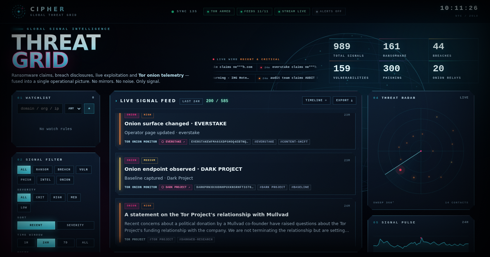

# ThreatGrid

**A live threat-intelligence console for defenders.**

ThreatGrid turns public threat feeds, vulnerability data, and Tor-only leak-site
signals into one real-time analyst view. Built for fast triage: see what changed,
rank it by severity, and open a concise brief without leaving the console.

## What it does

- **Live event wire** — ransomware claims, breach disclosures, new CVEs and
  exploits, phishing feeds, security news, and onion-site changes stream into a
  single timeline.
- **Severity-ranked triage** — filter critical/high signals, sort by recency or
  severity, and jump to the source.
- **Analyst briefs** — each event opens with context, indicators, and MITRE
  ATT&CK mapping. Briefs are generated locally, with no external AI calls.
- **Darkweb monitoring** — public onion claim sites are checked through Tor for
  availability, title changes, and new claims. Metadata only.
- **Watchlists and export** — track organizations, keywords, and indicators, and
  export filtered results.
- **Live updates** — server-sent events push new signals to the dashboard as
  collectors find them, with automatic stale/offline indicators.

## Data sources

ThreatGrid aggregates public defensive sources, including ransomware tracking
feeds, breach disclosures, NVD/CVE data, GitHub Security Advisories, exploit
feeds, phishing feeds, and security news. Tor monitoring covers publicly listed
onion claim pages.

## Safety by design

- Leak-site collection is **claim metadata only** — no dumps, files, or victim
  data are downloaded.
- No market logins, purchases, or credential use.
- Onion requests are GET-only, time-limited, byte-capped, and do not execute
  JavaScript or auto-follow links.
- Watchlist matching is local.
- Intended for authorized defensive research and situational awareness.

## Under the hood

A FastAPI service with async collectors, SQLite storage, server-sent events, and
a dependency-free browser client. The production image runs the dashboard and a
Tor SOCKS proxy together, so darkweb collection works on a single container or
VM.

## Live demo

**Deployment link: coming soon.**

This public repository is the project overview. The source repository is
private.

## Status

Actively developed. Follow this repository for the live instance and release
notes.
